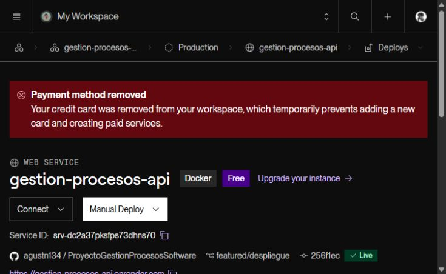
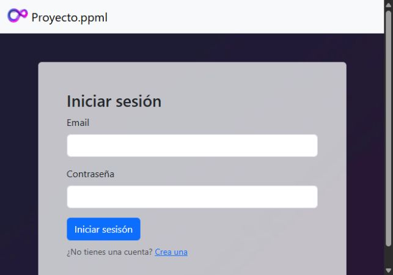
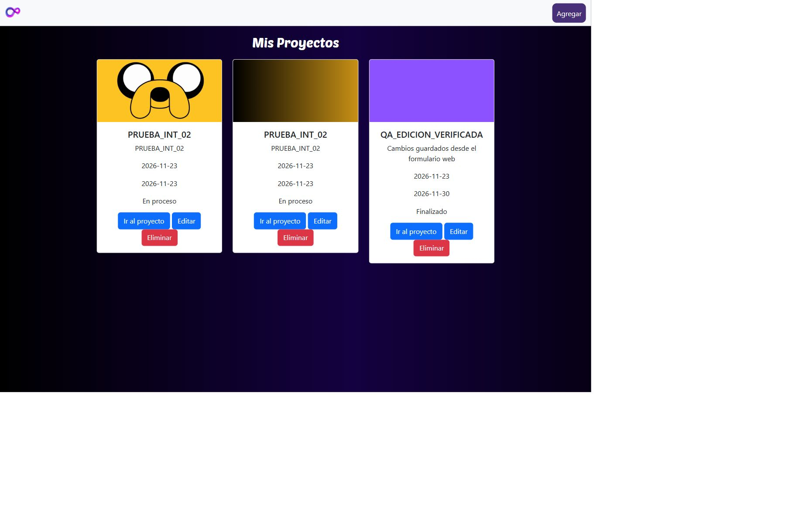

# ÍNDICE

1. Objetivo y actualización del proyecto

2. Pruebas y resultados

3. Despliegue de la aplicación

4. Funcionamiento comprobado

5. Seguridad y aspectos pendientes

6. Archivos de entrega y consulta

# 1. Objetivo y actualización del proyecto

La práctica consistió en actualizar los dos microservicios a Java 21, comprobar su funcionamiento y publicar la aplicación para acceder a ella por Internet. También se conservaron los archivos originales, las pruebas y las evidencias de cada etapa.

## Cómo está organizada la aplicación

El cliente web muestra las pantallas de registro, inicio de sesión y gestión de proyectos. La API recibe las solicitudes del cliente y consulta o guarda la información en la base de datos. En el despliegue, los dos servicios se ejecutan en Render y los datos se almacenan en TiDB Cloud.

## Qué se actualizó y para qué

- Java 21 en los dos microservicios y JDK 21 en Jenkins, para compilar y ejecutar con la misma versión principal.

- Maven 3.9.9 en Jenkins, para construir los proyectos con Java 21.

- SonarScanner 5.5.0.6356 en cada POM, para enviar el análisis del código a SonarQube.

- JaCoCo 0.8.12 y Surefire 3.2.5, para medir la cobertura y ejecutar las pruebas automatizadas.

- Spring Boot 3.5.16 y dependencias actualizadas durante la Parte 2, para resolver incompatibilidades y atender los avisos encontrados.

Los POM son los archivos donde Maven define versiones, dependencias y herramientas de construcción. Se entregan los dos originales y los dos actualizados de la Parte 1, identificados por microservicio. Los POM activos posteriores se conservan junto con el código de la entrega.

## Organización de las ramas

main conserva el estado estable de la Parte 1; develop sirve como punto de integración. Las ramas featured/parte-1, featured/parte-2 y featured/upgrade-java21 separan el trabajo de cada etapa. featured/despliegue contiene la publicación en la nube y la corrección de la edición de proyectos.

# 2. Pruebas y resultados

## Pruebas de la Parte 2

El 9 de noviembre de 2026 se aprobaron 123 pruebas: 58 del cliente, 57 de la API y ocho de la base de datos. Las comprobaciones abarcan datos válidos e incompletos, respuestas de los servicios, errores y operaciones de almacenamiento.

Los tres trabajos de Jenkins terminaron en SUCCESS en su ejecución #4: Practica3-Parte2-Frontend, Practica3-Parte2-Backend y Practica3-Parte2-BaseDatos. Estos resultados corresponden al commit 8a6491f y se conservan como evidencia de esa etapa.

## Cobertura de las pruebas

JaCoCo registró cobertura del 100% de los métodos evaluables: 97 de 97 en el cliente y 144 de 144 en la API. Esto significa que las pruebas ejecutaron esos métodos; no significa que todos los escenarios posibles estén cubiertos ni sustituye la revisión de las respuestas esperadas.

Se excluyeron únicamente las dos clases que arrancan las aplicaciones. Se mantienen dentro de la medición los modelos, controladores, servicios y objetos de solicitud. El detalle de líneas y condiciones está en los reportes de JaCoCo; el porcentaje indicado no corresponde a JavaScript.

## Comprobaciones del despliegue

El 23 de noviembre se volvieron a aprobar 57 pruebas de la API y 11 pruebas seleccionadas del cliente. Estas últimas comprueban la dirección de la API, el inicio de sesión, el alta y la edición de proyectos, la conservación del identificador y los mensajes de error.

También se documentaron 20 comprobaciones públicas: 13 sobre disponibilidad, registro, acceso y consulta, y siete de edición desde el navegador. Estas comprobaciones son posteriores a los trabajos de Jenkins y no se presentan como una nueva medición completa de cobertura.

## Dónde consultar los resultados

[Reportes de pruebas y cobertura de la Parte 2](https://github.com/agustn134/ProyectoGestionProcesosSoftware/tree/featured/parte-2/practica-3/parte-2)

[Evidencias y validación del despliegue](https://github.com/agustn134/ProyectoGestionProcesosSoftware/tree/featured/despliegue/despliegue/evidencias)

# 3. Despliegue de la aplicación

## Dónde se ejecuta cada parte

Render ejecuta el cliente web y la API como dos servicios Docker independientes, en el plan Free y la región Oregon. Cada imagen Docker reúne el programa y el entorno necesario para ejecutarlo. Jenkins y SonarQube se utilizan para comprobar el proyecto; la aplicación publicada funciona en Render.

TiDB Cloud Starter aloja la base dbgestor, con un límite de gasto de $0 al mes. Se crearon seis tablas en una base nueva, sin copiar datos personales de la base local. La conexión verifica el certificado de seguridad del servidor.

## Direcciones de acceso

[Abrir la aplicación](https://gestion-procesos-frontend.onrender.com)

[Comprobar la disponibilidad de la API](https://gestion-procesos-api.onrender.com/healthz)

## Configuración necesaria

El cliente utiliza API_BASE_URL para encontrar la API. Esta utiliza DB_URL, DB_USER y DB_PASSWORD para conectarse a TiDB. Las credenciales se guardaron como variables de Render y no se incluyen en el código ni en las capturas.

Ambos servicios aceptan el puerto que asigna Render. Para una ejecución local, la composición Docker publica el cliente en 8080 y la API en 8081. Jenkins y SonarQube locales utilizan 8090 y 9000 cuando Docker Desktop está disponible.

## Evidencia del despliegue de la API

Figura 1. API en Render: servicio Docker, plan Free y estado Live. Captura del 23 de noviembre de 2026.

El cliente quedó publicado con el commit 61ff730 y la API con el 256f1ec. Las instancias gratuitas pueden tardar en responder cuando se reactivan tras un periodo sin uso.

# 4. Funcionamiento comprobado

## Registro e inicio de sesión

Se comprobó el registro de cuentas ficticias y el acceso con una contraseña válida. Una contraseña incorrecta se rechazó con HTTP 401, que indica que las credenciales no permiten acceder. Las respuestas de acceso no incluyen el valor de la contraseña.

Figura 2. Pantalla de inicio de sesión de la aplicación publicada, sin credenciales visibles.

## Edición de proyectos

El formulario de edición intentaba crear un proyecto con un identificador ya existente. Se corrigió para actualizar el mismo registro. También se repararon el selector de fondos, las rutas de los colores y la carga del archivo JavaScript actualizado.

Figura 3. Proyecto ficticio QA_EDICION_VERIFICADA después de guardar nombre, descripción y fondo morado. Conservó el ID 30001 y los cambios permanecieron al recargar.

## Problemas resueltos durante la publicación

Al principio, el cliente devolvía un error al iniciar sesión aunque la API respondía correctamente. Se corrigió la forma de construir la respuesta del cliente. TiDB también rechazó la configuración de caracteres del esquema original; se preparó un esquema compatible, conservando el de MariaDB para el entorno local.

# 5. Seguridad y aspectos pendientes

## Qué se revisó

SonarQube revisó el código Java. OSV revisó las versiones de las dependencias y Gitleaks buscó credenciales guardadas en los archivos del proyecto. Se excluyeron target y los reportes generados del análisis como código, manteniendo el código fuente y las pruebas.

Se corrigieron problemas de validación de solicitudes y comparaciones incorrectas de valores vacíos. Los nuevos registros guardan contraseñas con BCrypt, que permite verificarlas sin almacenar el texto original. El registro asigna el rol Usuario y las respuestas evitan mostrar contraseñas.

## Resultados y límites

Los dos controles de calidad de SonarQube quedaron aprobados y el análisis no reportó vulnerabilidades de código. La revisión de dependencias conserva dos avisos de Spring por servicio: CVE-2026-47890 y CVE-2026-47884. Son resultados distintos y no deben confundirse.

Se documentó que el proyecto no utiliza las funciones relacionadas con esos dos avisos. La excepción se limita a las versiones e identificadores revisados y vence el 7 de diciembre de 2026; después debe reevaluarse o actualizarse la dependencia. La clasificación completa se conserva en los archivos de la Parte 2.

La aplicación aún requiere un control completo de sesiones y permisos para crear, consultar, modificar o eliminar datos. Por ello se utiliza con información de demostración. Las cuentas antiguas que guardaban contraseñas en texto claro requieren un restablecimiento autorizado.

## Datos de prueba y entorno local

Las ocho pruebas de base de datos se ejecutaron en MariaDB aislada, sin compartir almacenamiento con la base de trabajo. Los resultados de Jenkins se conservan aunque posteriormente Docker Desktop del equipo no pudo reiniciarse. El despliegue público en Render y TiDB se verificó por separado.

# 6. Archivos de entrega y consulta

## Qué contiene la entrega

- Parte 1: dos POM originales y dos actualizados, configuración de Java 21 y Maven en Jenkins y explicación de los cambios.

- Parte 2: resultados de los tres trabajos de Jenkins, pruebas, cobertura, revisión de seguridad y clasificación de hallazgos.

- Despliegue: Dockerfiles, composición local, configuración sin secretos, esquemas de base de datos, capturas y comprobaciones públicas.

## Imágenes de la interfaz

Se prepararon 13 recursos WebP: los originales sumaban aproximadamente 287 MB y las alternativas ocupan menos de 1 MB. Los recursos animados convertidos se representan mediante su primer fotograma estático. El detalle de los cambios se conserva en despliegue/optimizacion-imagenes.json.

## Ligas del código y las evidencias

[Microservicio del cliente: código y POM](https://github.com/agustn134/ProyectoGestionProcesosSoftware/tree/featured/despliegue/Ejercicio5Cliente)

[Microservicio de la API: código y POM](https://github.com/agustn134/ProyectoGestionProcesosSoftware/tree/featured/despliegue/Ejercicio5MyAPIGestor)

[Resultados de Jenkins, pruebas y cobertura](https://github.com/agustn134/ProyectoGestionProcesosSoftware/tree/featured/parte-2/practica-3/parte-2)

[Configuración y validación del despliegue](https://github.com/agustn134/ProyectoGestionProcesosSoftware/blob/featured/despliegue/despliegue/VALIDACION_DESPLIEGUE.md)

Las capturas muestran el estado observado el 23 de noviembre de 2026. Los reportes de Jenkins y cobertura conservan su fecha, revisión y alcance originales. Las credenciales privadas no forman parte de la entrega.

